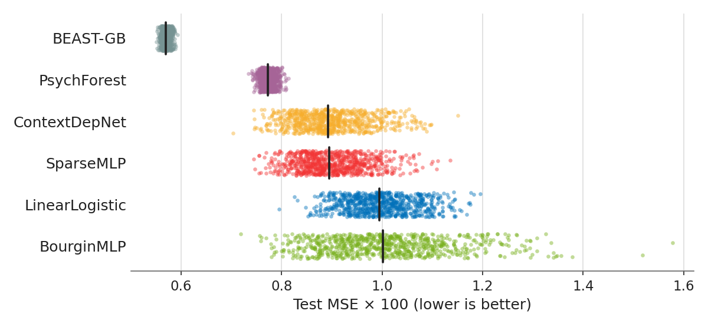

# Variance-aware evaluation of CPC18 choice prediction models

<p align="center"><a href="https://doi.org/10.5281/zenodo.24013058"></a></p>

Train the same model twice with different random seeds and you get two different results. This repository measures how
large that variability is in models that predict human decisions, and what it means when you compare them.

It uses the [Choice Prediction Competition 2018](https://cpc-18.com/) (CPC18): given a choice between two lotteries,
predict the share of people who pick each one. Six model families are trained 800 times each from a shared pool of
seeds, and two hyperparameter grids and a factorial of weight initialization by data order go further. From those runs
it estimates the distribution of the test error of each model, the probability that a given number of runs ranks two
models in the wrong order, and how many runs it takes to reach a target error.

<!-- Written by scripts/readme_figure.py -->
<p align="center">
  
</p>

<p align="center"><em>Each dot is one of the 800 training runs of a model under the stable protocol, each with a different random seed, and the black line is the median (lower is better). ContextDepNet has a better best run than PsychForest, 0.704 against 0.734, yet PsychForest wins 97% of the single-run comparisons.</em></p>

Across the six models, a leaderboard built from a single run is misranked 83% of the time, mostly within two nearly tied
pairs. Data order carries 4 to 45% of the seed variance, depending on the model, and the sampling of the test problems
contributes more uncertainty than the seed in all six. The repository also keeps the original training protocol, the
fragile configuration of the article: there a poor initialization gives BourginMLP a heavy tail, with 70% of its variance
in the interaction of initialization and data order, and same-seed results can change from one machine to another, while
the distribution of the results holds.

## 📄 Article and data

The repository holds the code behind this article:

> Heredia-Aguado, E., Rujano, A., Valiente, D., & Gil, A. *Variance-Aware Evaluation of Behavioral Choice Prediction
> Models: A Replication and Extension on the Choice Prediction Competition 2018*. Manuscript submitted for publication.

- **Data deposit:** the results of every trial, the machines used and the CPU probes are archived in Zenodo at
  [doi.org/10.5281/zenodo.23978015](https://doi.org/10.5281/zenodo.23978015), public once the article is published,
  under the CC BY 4.0 license. Its README documents every field.
- **MLV Tools:** interactive browser of the results, live at
  [enheragu.github.io/mlv-tools](https://enheragu.github.io/mlv-tools)
  ([doi.org/10.5281/zenodo.20268237](https://doi.org/10.5281/zenodo.20268237)).
- **Same method on computer vision:**
  [mnist-learning-playground](https://github.com/enheragu/mnist-learning-playground) applies it to image classification
  and object detection. This repository reuses its utilities as a git submodule.

## 🚀 Installation

```sh
git clone --recurse-submodules https://github.com/enheragu/cpc18-learning-playground.git
cd cpc18-learning-playground
python3 -m venv venv
source venv/bin/activate
pip install -r requirements.lock
```

To check the setup, run the tests, which take a few seconds:

```sh
pip install pytest
python -m pytest tests
```

`requirements.lock` pins the versions used for the article (Python 3.12), and `requirements` lists the same packages
unpinned. The standard PyTorch package carries CUDA and takes about 8 GB once installed. To avoid it, run
`pip install torch==2.10.0 --index-url https://download.pytorch.org/whl/cpu` first. Training runs on CPU;
`CPC18_USE_GPU=1` uses a GPU in the main trainers, which is not faster on this problem size.

The archived release of the code (the Zenodo zip) does not contain the submodule. Clone it into its folder at the commit
pinned by this repository, which is its release v1.0.1, archived at
[10.5281/zenodo.24003005](https://doi.org/10.5281/zenodo.24003005):

```sh
git clone https://github.com/enheragu/mnist-learning-playground.git mnist-learning-playground
git -C mnist-learning-playground checkout 6470629e42f1f8d3ceb7e0025b0f34aee99e39fc
```

## ▶️ Usage

### Regenerate the article from the data deposit

No training is needed. Put the files of the deposit, version 1.1 or later, in `zenodo_export/` at the root of the
repository; the first four scripts below also take another folder with `--deposit`. The article rests on the stable
configuration (see [Training protocols](#-training-protocols)):

```sh
cd src
python 05_make_paper_figures.py --protocol stable    # Figures, to analysis_results/figures_stable/
python 17_article_tables.py --protocol stable        # Tables computed from the deposit alone
python 20_stable_numbers.py                          # Numbers quoted in the text
python 21_ablation_trees_stable.py                   # Sequential decision trees of the ablations
```

The figures of the stable mode are those that differ from the original protocol. The article also reports the original
protocol as its fragile configuration (Section 3.6) and runs on it the replication across machines (Section 3.5 and
Appendix D), whose tables are also printed by the stable mode of `17_article_tables.py`. The figure of that replication
and the analyses of the original protocol come from:

```sh
cd src
python 09_export_csv.py                  # Flat CSVs, read by several of the scripts below
python 10_paper_tables.py                # Summary, misranking, normality, ICC and ANOVA tables
python 17_article_tables.py              # Tables computed from the deposit alone
python 18_text_numbers.py                # Numbers quoted in the text of the article
python 05_make_paper_figures.py          # Figures
python 02_analyze.py --mode shared_pool --regime 2
python 06_analyze_decomp.py
python 07_analyze_ablation.py
python 08_power_analysis.py
python 13_variance_components.py
python 14_gaussian_calibration_audit.py
python 15_parametric_family_audit.py
python 12_determinism_audit.py           # Retrains some models and compares them with the stored values
python 22_initial_saturation.py          # Output of BourginMLP before any training
```

Tables, figures and CSVs are written to `analysis_results/`, and several scripts also print their values.
[`src/README.md`](src/README.md) maps each script to the sections of the article.

Three things to keep in mind:

- **Training results take priority.** Each script reads the log in `output_data/` when it exists, and the deposit
  otherwise, so a partial training run replaces the deposit for that log. `CPC18_READ_DEPOSIT=1` selects the deposit
  even when the logs are there.
- **The exploratory first regime is not in the deposit.** Its CSV and its row of the ICC precision table are left out.
  Those are not in the article, whose figures and tables come out the same from either source.
- **The determinism audit depends on the machine.** The same seed gives the same result only on the arithmetic path of
  the reference machine (Appendix D of the article), so `12_determinism_audit.py` reports mismatches, and ends with an
  error, on other paths.

### Train from scratch

```sh
cd src
python 01_train_regime2.py --workers 6                    # Main run: 6 models x 800 runs
python 04_train_ablation.py --study b1 --workers 6        # BourginMLP: batch size x learning rate
python 04_train_ablation.py --study b1x --workers 6       # BourginMLP: grid-sensitivity column
python 04_train_ablation.py --study b3 --workers 6        # SparseMLP: sparsity x learning rate
for m in BourginMLP LinearLogistic ContextDepNet SparseMLP; do
    python 03_train_decomp.py --model $m --workers 6      # Initialization x data order: 35 x 35 runs
done
python 11_train_valsplit.py --workers 2                   # Early stopping on a validation split
python split_variance_rerun.py                            # Variance from the split of the problems
python perproblem_rerun.py                                # Error per test problem
```

The trainers write to `output_data/`, one YAML per model and experiment. Running one again only adds the missing seeds, so
a run can be interrupted and resumed; for parallel runs use `--workers` rather than starting it twice. The two re-runs train
everything again and write to `analysis_results/`. The main, ablation and factorial experiments take about 93 single-core
hours. These commands train under the original protocol; the next section adds the stable one.

`python 16_export_zenodo.py --added-runs DIR` rebuilds the deposit: it needs the logs and machine-information files of
every machine, the CPU probes, the outputs of the re-runs and, from version 1.1 of the deposit, the folder of the runs
added in that version, as their runners logged them. It replaces a previous export only once the new one is complete, and
`--out` writes it elsewhere, e.g. `--out ../zenodo_export_v1.1`.

## 🧪 Training protocols

Every trainer and re-run takes `--protocol original` (the default) or `--protocol stable`:

- **original**: the protocol of release 1.0.0 and of version 1.0 of the data deposit, and the fragile configuration of
  the article. Each network starts from its own
  initialization (Kaiming normal in fan-out mode with zero biases, or LinearLogistic's uniform weights), and each run
  reports the test MSE of its epoch with the lowest test MSE. Early stopping on the test curve, patience 50.
- **stable**: the configuration on which the article rests. Each network starts from the default initialization of PyTorch for its linear layers, drawn from the
  training seed without changing the data order of that seed, and each run reports its test MSE at a fixed number of
  epochs per configuration, chosen by 5-fold cross-validation on the 208 training problems, never at the minimum of the
  test curve. Early stopping on the test curve, with patience 50 (120 for LinearLogistic, so that every run reaches its
  epoch 99), only decides when to stop. The whole curve is kept, and its minimum is logged too, as a sensitivity readout.

Everything else is the same under both: architectures, optimizer, batch size and learning rate, features, split, seed
pools, factorial design and ablation grids. PsychForest and BEAST-GB have no initialization nor epochs, so their results
serve both protocols and they are trained only under the original one. The stable protocol writes to
`output_data_stable/` (`output_data_stable_<TAG>/` with `CPC18_OUTPUT_TAG`), so its logs never mix with those of the
original protocol, and its re-runs write there too. Version 1.1 of the data deposit holds both protocols, told apart by its
`protocol` column; the analysis scripts read the original one, except `20_stable_numbers.py`,
`21_ablation_trees_stable.py` and the `--protocol stable` mode of the figures and the tables.

The fixed number of epochs of each configuration is in `data/cv_epochs.csv`, which `src/19_cv_epochs.py` writes and the
trainers read. To train under the stable protocol:

```sh
cd src
python 01_train_regime2.py --protocol stable --workers 6               # Main run: the 4 neural models x 800 runs
python 04_train_ablation.py --study b1 --protocol stable --workers 6
python 04_train_ablation.py --study b1x --protocol stable --workers 6
python 04_train_ablation.py --study b3 --protocol stable --workers 6
for m in BourginMLP LinearLogistic ContextDepNet SparseMLP; do
    python 03_train_decomp.py --model $m --protocol stable --workers 6
done
python split_variance_rerun.py --protocol stable                       # The 4 neural models on the 20 re-splits
python perproblem_rerun.py --protocol stable                           # Trained for their fixed number of epochs
```

To repeat the cross-validation, which took about two and a half hours on two workers of the reference machine:

```sh
python 19_cv_epochs.py --workers 2      # Validation curves, to output_data_stable/cv_epochs.jsonl (resumable)
python 19_cv_epochs.py --summary        # data/cv_epochs.csv
```

`scripts/variance_check/protocol_check.py` retrains a sample of trials under each protocol and compares them bit for bit
with release 1.0.0 (original protocol) and with the runs of version 1.1 of the deposit (stable protocol), and checks an
export of the deposit against the runs it was built from.

## 🧠 Models

| Model | What it is | Size | Test MSE x 100, mean ± std of 800 runs, stable protocol | Original protocol |
|:------|:-----------|:-----|:--------------------------------------:|:--------------------------------------:|
| BEAST-GB | Gradient-boosted trees, the winner of CPC18 | 978 trees | 0.570 ± 0.007 | 0.570 ± 0.007 |
| PsychForest | Random forest | 500 trees | 0.773 ± 0.013 | 0.773 ± 0.013 |
| ContextDepNet | Small network, 32 and 32 units with sigmoid activations | 2,305 parameters | 0.898 ± 0.071 | 1.031 ± 0.159 |
| SparseMLP | BourginMLP with a static sparse mask | about 22,400 active of 90,576 parameters | 0.901 ± 0.065 | 1.055 ± 0.144 |
| LinearLogistic | A single linear layer, the linear control | 38 parameters | 0.998 ± 0.067 | 0.953 ± 0.046 |
| BourginMLP | Dense network, 200, 275 and 100 units | 90,576 parameters | 1.009 ± 0.122 | 1.032 ± 0.480 |

[`src/cpc18_models/README.md`](src/cpc18_models/README.md) has the details of each one and how it differs from its
published version.

## 🗂️ Scripts and outputs

| Script | What it does |
|:-------|:-------------|
| `src/01_train_regime2.py` | Main run: six models on the BEAST features, 800 shared seeds each. |
| `src/04_train_ablation.py` | Ablations: BourginMLP and SparseMLP over 3 x 3 grids, plus a grid-sensitivity column. |
| `src/03_train_decomp.py` | Factorial: 35 initialization seeds x 35 data-order seeds, four neural models. |
| `src/11_train_valsplit.py`, `src/split_variance_rerun.py`, `src/perproblem_rerun.py` | Early stopping on a validation split, variance from the split of the problems, and error per test problem. |
| `src/00_train_models.py` | Exploratory first regime on the raw lottery parameters, not reported in the article. |
| `src/02_analyze.py`, `src/07_analyze_ablation.py` | Misranking by Monte Carlo and Bootstrap, ICC and Spearman, and ablation ANOVA. |
| `src/06_analyze_decomp.py`, `src/13_variance_components.py` | Decomposition and variance components of the factorial. |
| `src/08_power_analysis.py` | Precision and statistical power of the headline statistics. |
| `src/05_make_paper_figures.py` | Figures; `--media PATH` also copies the ones a LaTeX project includes. |
| `src/09_export_csv.py`, `src/10_paper_tables.py`, `src/17_article_tables.py` | Flat CSVs and tables of the article. |
| `src/18_text_numbers.py` | Numbers quoted in the text of the article that no other script prints. |
| `src/20_stable_numbers.py` | The same for the article in the stable configuration, from version 1.1 of the deposit. |
| `src/21_ablation_trees_stable.py` | Sequential decision trees of the two ablations in the stable configuration: TikZ trees and the probability of reaching the best cell. |
| `src/22_initial_saturation.py` | Output of BourginMLP before any training under the initialization of the original protocol. |
| `src/12_determinism_audit.py` | Retrains some cells of the factorial and compares the test MSE bit for bit. |
| `src/14_gaussian_calibration_audit.py`, `src/15_parametric_family_audit.py` | How well the Gaussian and other families fit the lower tail. |
| `src/16_export_zenodo.py` | Builds the public deposit from the training logs and the runs added in its version 1.1. |
| `src/19_cv_epochs.py` | Cross-validation of the number of epochs of each configuration under the stable protocol. |
| `scripts/variance_check/` | Replication across machines, and reproduction checks of the two protocols. |
| `scripts/export_web_data.py` | Data files for MLV Tools. |
| `scripts/precompute_features.R` | BEAST-derived features, from the reference code of BEAST-GB. |
| `scripts/readme_figure.py` | Figure of this README, from the main run of the stable protocol in the deposit. |

| Folder | What it holds |
|:-------|:--------------|
| `data/` | The feature table and the fixed numbers of epochs of the stable protocol, committed. The raw CPC18 data, downloaded when the first regime needs it. |
| `deps/` | Reference code of BEAST-GB, fetched by `deps/download.sh`, not committed. |
| `output_data/`, `output_data_<TAG>/` | Training logs of the reference machine and of the others, not committed. |
| `output_data_stable/`, `output_data_stable_<TAG>/` | Training logs and re-runs of the stable protocol, not committed. |
| `analysis_results/` | Tables, figures and flat CSVs, not committed. |
| `zenodo_export/` | The data deposit, not committed. |
| `media/` | Figure of this README. |

## 📚 Extra documentation

- [src/README.md](src/README.md): experiments, the script behind each section of the article, and the flat CSVs.
- [src/cpc18_models/README.md](src/cpc18_models/README.md): the models and how they differ from the published ones.
- [scripts/variance_check/README.md](scripts/variance_check/README.md): replication across machines.
- [data/README.md](data/README.md): provenance, license and regeneration of the feature table.
- [CHANGELOG.md](CHANGELOG.md): history of the project, version by version.

## 📝 How to cite

If you use this software, please cite it: the metadata are in [`CITATION.cff`](CITATION.cff), and GitHub's *Cite this
repository* button exports them as APA or BibTeX. The DOI [10.5281/zenodo.24013058](https://doi.org/10.5281/zenodo.24013058)
always resolves to the latest release; each release also has its own DOI (v1.1.0:
[10.5281/zenodo.24094132](https://doi.org/10.5281/zenodo.24094132); v1.0.0:
[10.5281/zenodo.24013059](https://doi.org/10.5281/zenodo.24013059)), which is the one to cite when reporting results
obtained with that version. When reporting results, please also cite the article above.

## ⚖️ License

The code in this repository is released under the [MIT License](LICENSE). The feature table `data/cpc18_features.csv` is
derived from the CPC18 data and is distributed under CC BY 4.0; see [`data/README.md`](data/README.md).

## 🐛 Bug reports & Contact

If you find a bug or have a question, please
[open an issue](https://github.com/enheragu/cpc18-learning-playground/issues) or contact the maintainer via
[email](mailto:e.heredia@umh.es).
